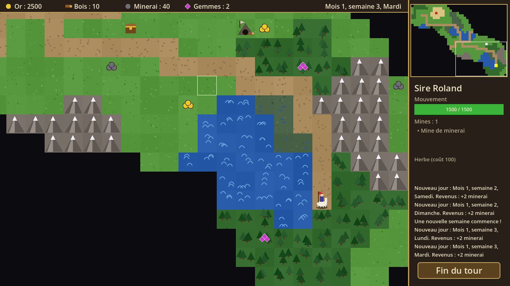

# Carte d'aventure – Godot 4.7 + C#

Version Godot de la carte d'aventure. **Tout est construit par le code C#** : carte, dessin, interface.
L'éditeur Godot n'est pas nécessaire pour développer, seulement pour lancer le jeu si on le souhaite.



## Installer (Windows, une seule fois)

1. **.NET SDK 8** (ou plus récent) : https://dotnet.microsoft.com/download
2. **Godot 4.7.2, édition .NET** : https://godotengine.org/download/windows/
   (choisir « Godot Engine – .NET »). C'est un zip sans installation : décompressez-le par exemple dans `C:\Godot\`.

## Lancer le jeu

**Avec le script** : double-cliquez sur `godot\lancer.bat`.
Le script cherche Godot dans `C:\Godot\` (directement ou dans le sous-dossier `Godot_v4.7.2-stable_mono_win64\`). Ailleurs, définissez la variable d'environnement `GODOT` avec le chemin complet de l'exe.

**À la main**, dans un terminal ouvert dans le dossier `godot` :

```
dotnet build
C:\Godot\Godot_v4.7.2-stable_mono_win64\Godot_v4.7.2-stable_mono_win64.exe --path .
```

**Avec l'éditeur Godot** : ouvrez Godot, « Importer », choisissez `godot/project.godot`, puis appuyez sur F5.

Pour toujours obtenir la même carte, ajoutez une graine : `lancer.bat -- --seed=42`.
Pour le développement, `-- --reveal` retire le brouillard de guerre.

## Commandes

| Action | Commande |
|---|---|
| Tracer un chemin | Clic gauche sur une case |
| Partir | Second clic sur la même case, ou Espace |
| Annuler le chemin | Clic droit ou Échap |
| Faire défiler la carte | Flèches, ZQSD, souris au bord de l'écran, clic sur la mini-carte |
| Recentrer sur le héros | C |
| Écran de ville | Entrer dans sa ville, ou clic sur sa ville quand le héros y est (Échap pour revenir) |
| Fin du tour | Bouton « Fin du tour » ou Entrée |

Points verts : cases atteignables aujourd'hui. Points rouges : il faudra les jours suivants.

Les **monstres** attaquent le héros qui entre sur une case voisine. Survolez-les pour voir le danger estimé du combat.
Une **ville neutre** se trouve à mi-distance du départ : battez sa garnison pour la prendre. Elle rapporte de l'or chaque jour.
Le combat est automatique. Perdre ses héros et ses villes fait perdre la partie ; vaincre tous les monstres la fait gagner.

## Organisation du code

Le code est séparé en deux parties :

- `scripts/Core/` : **les règles du jeu en C# pur**, sans aucune dépendance à Godot.
  On peut les tester sans lancer le jeu, et les réutiliser ailleurs (générateur de cartes, serveur…).
  - `MapGenerator.cs` : génération aléatoire de la carte (graine = carte reproductible) ; monstres neutres, plus forts loin du départ
  - `AdventureMap.cs` : terrain, objets, zones de contrôle des monstres
  - `FogOfWar.cs` : brouillard de guerre (un par joueur)
  - `Pathfinder.cs` : recherche du chemin (A*) avec coûts de terrain
  - `MapObjects.cs` : tas de ressources, coffres, mines, monstres
  - `GameData.cs` : les données du jeu (créatures, bâtiments) lues depuis `data/`
  - `Creature.cs` : types de créatures, lus depuis `data/creatures.json`
  - `Town.cs` : villes (bâtiments, créatures à recruter, garnison)
  - `Army.cs` : armées (7 troupes au maximum)
  - `Battle.cs` : combat automatique
  - `Player.cs`, `Hero.cs` : trésor, mines, héros, armée, points de mouvement
  - `GameState.cs` : la partie (joueurs et tours, calendrier, déplacement, combats, victoire et défaite, journal)
- `scripts/Game/` : **l'affichage et les commandes avec Godot**
  - `Main.cs` : point d'entrée, relie les commandes du joueur aux règles et les événements à l'affichage
  - `MapCamera.cs` : caméra de la carte (défilement, recentrage)
  - `TerrainLayer.cs`, `ActorLayer.cs`, `FogLayer.cs` : les calques de la carte
  - `MapRenderer.cs` : dessin des tuiles, objets et du héros (à remplacer plus tard par des images)
  - `Hud.cs`, `Minimap.cs`, `ResourceIcon.cs` : le panneau et la barre du haut
  - `TownScreen.cs` : l'écran de ville
  - `Ui.cs` : couleurs et outils communs à l'interface
  - `Texts.cs` : tous les textes affichés (noms, date, journal). Sans Godot, donc testé avec les règles
- `scenes/Main.tscn` : la seule scène, un nœud vide qui porte `Main.cs`.
- `data/creatures.json`, `data/buildings.json` : les créatures et les bâtiments (modifiables sans toucher au code).

Les tests des règles sont dans `tests/HoMM.Core.Tests` (à la racine du dépôt) : `dotnet test`.
La solution `HoMM.sln` à la racine s'ouvre dans Visual Studio ou Rider.
